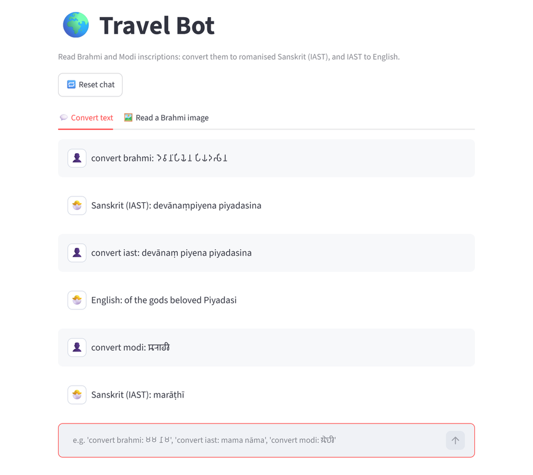
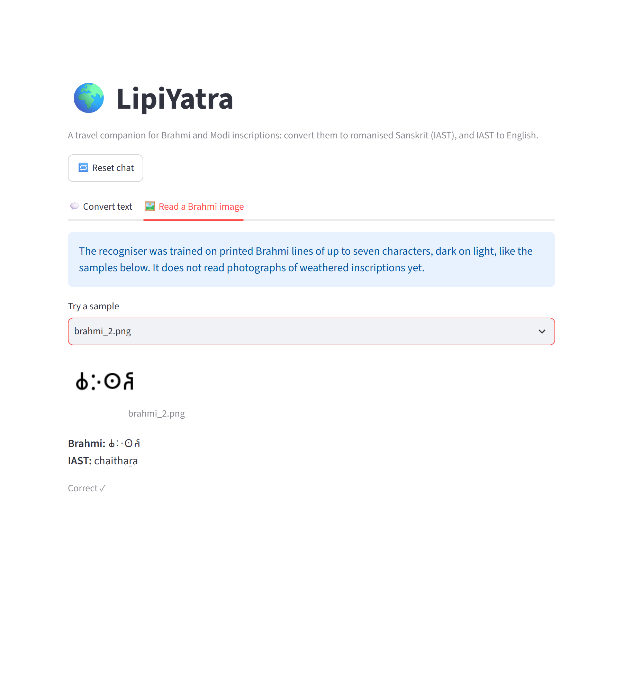

<h1 align="center">LipiYatra</h1>

<p align="center"><strong>A travel companion that reads ancient Indian scripts: Brahmi and Modi to romanised Sanskrit, Sanskrit to English, and printed Brahmi from images.</strong></p>

<p align="center">
  <a href="https://github.com/Cl0ud-9/LipiYatra/actions/workflows/ci.yml"></a>
  <a href="LICENSE"></a>
  
  <a href="https://www.kaggle.com/datasets/paragtonpe/brahmi-ocr-synthetic-dataset"></a>
</p>

<p align="center">
  <a href="#quick-start">Quick start</a> &nbsp;·&nbsp;
  <a href="#the-api">The API</a> &nbsp;·&nbsp;
  <a href="#how-it-works">How it works</a> &nbsp;·&nbsp;
  <a href="#the-brahmi-recogniser">The recogniser</a> &nbsp;·&nbsp;
  <a href="#data">Data</a> &nbsp;·&nbsp;
  <a href="#honest-limits">Honest limits</a>
</p>

<br>

<p align="center">
  
  &nbsp;
  
</p>

<p align="center"><sub>Left: Brahmi from Ashoka's edicts to IAST, IAST to English, and Modi to IAST. Right: the recogniser reading a held-out Brahmi line.</sub></p>

<br>

Brahmi, the script of Ashoka's edicts, and Modi, used to write Marathi for centuries, are carved and written across
India's heritage sites, and few visitors can read them. LipiYatra turns either script into IAST, the standard
romanisation of Sanskrit, and IAST into a word-by-word English gloss. It also reads printed Brahmi from an image with
a recognition model trained for this project.

The name joins *lipi*, script, and *yātrā*, journey. LipiYatra is the script-reading core of **Travel Bot**, a B.Tech
major project: a travel assistant for heritage sites, described in the project's research paper.

| You give it | You get | Example |
|---|---|---|
| Brahmi text | IAST | `𑀤𑁂𑀯𑀸𑀦𑀁𑀧𑀺𑀬𑁂𑀦` → *devānaṃpiyena* |
| Modi text | IAST | `𑘦𑘨𑘰𑘙𑘲` → *marāṭhī* |
| IAST | English, word by word | *agni jala* → *Fire Water* |
| An image of printed Brahmi | The Brahmi text and its IAST | see [samples/](samples) |

## Quick start

You need Python 3.11, 3.12, 3.13 or 3.14.

```bash
git clone https://github.com/Cl0ud-9/LipiYatra.git
cd LipiYatra
python -m venv .venv
.venv\Scripts\activate          # macOS/Linux: source .venv/bin/activate
pip install -r requirements.txt
python scripts/download_dictionary.py   # the Sanskrit-English dictionary, about 9 MB
```

Then start the API and the app, each in its own terminal:

```bash
python api.py                   # http://127.0.0.1:8001
streamlit run app.py            # opens http://localhost:8501
```

In the chat, type `convert brahmi: 𑀫𑀫 𑀦𑀸𑀫`, `convert modi: 𑘦𑘻𑘟𑘲` or `convert iast: mama nāma`. The **Read a
Brahmi image** tab has sample images to try. Without the dictionary, IAST to English still works for the built-in
word list.

## The API

Interactive documentation is at `http://127.0.0.1:8001/docs` while the API runs.

| Method and path | Body | Returns |
|---|---|---|
| `POST /brahmi-to-iast` | `{"text": "𑀫𑀫 𑀦𑀸𑀫"}` | `{"output": "mama nāma"}` |
| `POST /modi-to-iast` | `{"text": "𑘦𑘻𑘟𑘲"}` | `{"output": "modī"}` |
| `POST /iast-to-english` | `{"text": "mama nāma"}` | `{"output": "my name"}` |
| `POST /ocr/brahmi` | an image file in the form field `image` | `{"brahmi": "𑀙𑀇𑀣𑀶", "iast": "chaithaṟa"}` |
| `GET /health` | | status, version, dictionary size |

```bash
curl -F "image=@samples/brahmi_2.png" http://127.0.0.1:8001/ocr/brahmi
```

Text is limited to 5,000 characters and images to 5 MB. Set `API_BASE_URL` for the app if the API runs elsewhere, and
`ALLOWED_ORIGINS` (comma-separated) for browsers that call the API directly.

## How it works

```
Brahmi / Modi text ──> transliterate.py ──> IAST ──> translate.py ──> English gloss
                         (Unicode names)              (word list, then Wilson's dictionary)
Brahmi image ──> ocr.py: 256x64 grey ──> CRNN (ONNX) ──> CTC decoding ──> Brahmi text ──> IAST
```

- **Transliteration.** Brahmi and Modi are abugidas: each consonant carries an "a" unless a vowel sign or the virama
  follows it. The letter tables are built from the Unicode character names (`MODI VOWEL SIGN II` is ī), so every
  letter, vowel sign, digit and mark maps to the sound its name gives. Brahmi number signs become their value, as in
  `[20]`.
- **English.** Each word is looked up in a small list of common and inscription words, then in H. H. Wilson's
  Sanskrit-English dictionary of 1832 (43,935 headwords). Words are matched in the dictionary's own transliteration,
  with case endings dropped and its old spellings tried, and a noun is preferred over a verb root of the same spelling.
- **Recognition.** A convolutional network reads the image into 32 slices, a two-layer bidirectional LSTM reads the
  slices in order, and CTC decoding turns the result into characters.

## The Brahmi recogniser

The model was trained on 10,000 synthetic lines: one to seven of the 109 Brahmi characters in the Noto Sans Brahmi
font, rendered in black on a 256x64 white image at 32-48 px. [notebooks/brahmi_crnn.ipynb](notebooks/brahmi_crnn.ipynb)
trains it and exports it to ONNX.

| Measured on 1,999 held-out lines | Result |
|---|---|
| Character error rate | 11.1% |
| Lines read exactly right | 78.9% |

The held-out lines are the 20% the training notebook set aside (`train_test_split`, `random_state=42`). The six
images in [samples/](samples) are held-out lines too; one of them, `brahmi_6.png`, is read with one wrong character.

The training data, the checkpoints and the training logs are on Kaggle:
**[Brahmi OCR synthetic dataset](https://www.kaggle.com/datasets/paragtonpe/brahmi-ocr-synthetic-dataset)**.

## Data

| Dataset | Used for | Source |
|---|---|---|
| Brahmi OCR synthetic dataset | Training and testing the Brahmi recogniser | Made for this project: [Kaggle](https://www.kaggle.com/datasets/paragtonpe/brahmi-ocr-synthetic-dataset) |
| MODI-HChar, historical Modi handwritten characters (57 classes) | The project's Modi character classifier, an experiment not used by the app or included here | M. Deshmukh and S. Kolhe, [Mendeley Data](https://data.mendeley.com/datasets/pk2zrt58pp/1), DOI 10.17632/pk2zrt58pp.1, CC BY 4.0 |
| H. H. Wilson, *A Dictionary in Sanscrit and English* (1832) | IAST to English | [Cologne Digital Sanskrit Dictionaries](https://www.sanskrit-lexicon.uni-koeln.de), CC BY-SA 4.0, downloaded by `scripts/download_dictionary.py` |
| Noto Sans Brahmi font | Rendering the synthetic lines | [Google Fonts](https://fonts.google.com/noto/specimen/Noto+Sans+Brahmi), SIL Open Font License 1.1 |

## Honest limits

<details>
<summary>What the project does not do yet, and why</summary>

<br>

- **It does not read photographs of inscriptions.** The recogniser has only seen clean, synthetic lines in one font.
  Photos of carved or weathered stone, and even printed text at other sizes or positions, are mostly misread. The
  app says so next to the uploader.
- **Seven characters at most.** The model was trained on lines of one to seven characters.
- **No Modi recognition.** Modi text can be transliterated, but there is no Modi image model in the app.
- **English is a glossary, not a translation.** Each word gets its first dictionary sense, with no grammar, so
  sentences read like word lists and some senses are the wrong one for the context. The dictionary is from 1832.
- **The travel agents are not here.** Travel Bot's trip suggestions, weather updates and emergency-services help,
  which the research paper describes as LangGraph agents, are not part of this repository. LipiYatra is the
  script-reading part.
- **Prakrit is read as Sanskrit.** Ashoka's inscriptions are in Prakrit, so many words are not in a Sanskrit
  dictionary and are returned as they are.

</details>

## Project structure

```text
api.py                     FastAPI: transliteration, translation and recognition endpoints
app.py                     the LipiYatra chat, a Streamlit app
brahmi_modi/
  transliterate.py         Brahmi and Modi to IAST
  translate.py             IAST to English
  ocr.py                   Brahmi recognition with ONNX Runtime
models/                    the recogniser (ONNX) and its character list
samples/                   held-out Brahmi lines with their text
scripts/download_dictionary.py
notebooks/                 dataset generation, training and research (see notebooks/README.md)
tests/                     pytest suite
```

## Development

```bash
pip install -r requirements-dev.txt
python scripts/download_dictionary.py
ruff check .
pytest
```

The tests check that every Brahmi and Modi letter, vowel sign and digit is mapped, spot-check the mappings against
their Unicode names, and cover the dictionary lookup, the recogniser on the
samples, and every API endpoint, including its limits. They run on every push for Python 3.11 to 3.14. See
[CONTRIBUTING.md](CONTRIBUTING.md) before opening a pull request, and [SECURITY.md](SECURITY.md) to report a
vulnerability. [CHANGELOG.md](CHANGELOG.md) says what changed in each version.

## License

The project is **source-available**: Copyright 2025-2026 Cloud/9, all rights reserved. You can read the source, run it
and its models for personal, educational and non-commercial research use, and fork it to contribute back.
Redistributing it, publishing modified copies, running it as a service for other people, selling it, or using it or
its models to train other models is not allowed without written permission. See [LICENSE](LICENSE) for the full terms.

The Kaggle dataset is licensed separately under [CC BY-NC-SA 4.0](https://creativecommons.org/licenses/by-nc-sa/4.0/).
The dictionary and the libraries the project uses keep their own licenses, listed in [NOTICE](NOTICE).

<br>

<p align="center">
  <sub>Made by <a href="https://github.com/Cl0ud-9">Cloud/9</a>.</sub>
</p>
